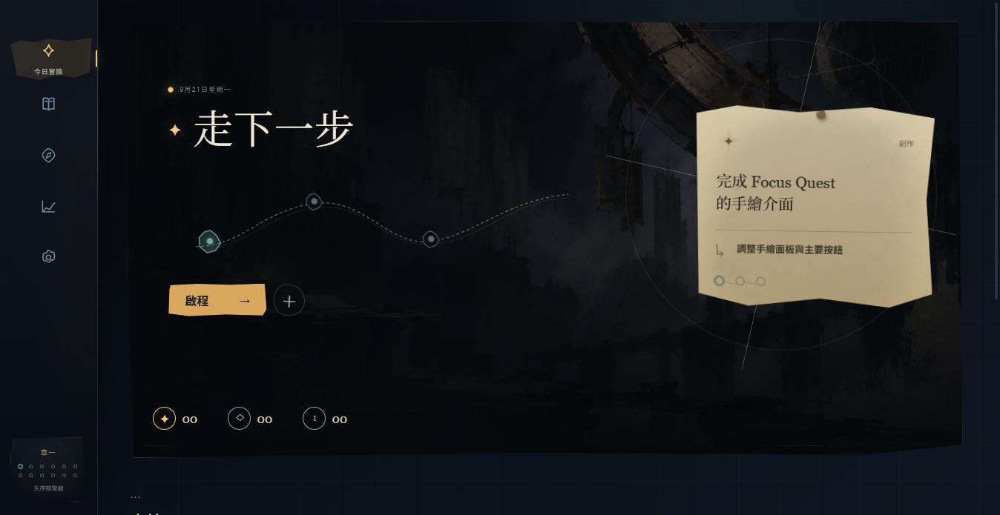
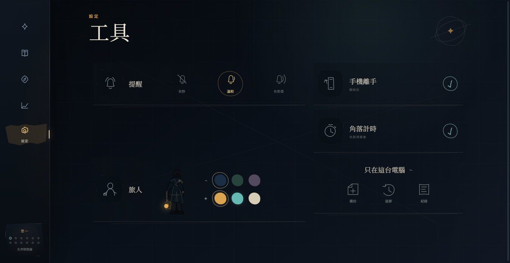

# Focus Quest for Windows

Focus Quest 是一套本機優先的 Windows 專注 RPG。它把每日任務縮成一個主線、兩個支線，協助使用者定義今天想看見的進展；需要時再提供三個起跑方式，使用者可選一個、改寫或直接跳過。

## Beta 0.5 功能

- 「手繪故事書 × 動態檔案館」介面；UI 是世界中的索引頁、路線筆記與星圖紀錄，不是一般軟體卡片。
- 統一的動態語言：墨刷換頁、筆畫寫入、清單錯峰進場、按壓縮放與克制的待機呼吸。
- 原創線稿 icon、不規則紙頁輪廓、石墨紙張材質與不對稱構圖；避免玻璃面板、dashboard 和大量圓角卡片。
- 一個主線、最多兩個支線，其餘保留在任務庫。
- 臨時需要換事情時可「暫放」主線；任務內容、起跑提示與既有紀錄都不會刪除，之後可再排回今日冒險。
- 輸入錯誤時可永久刪除任務；刪除前會清楚確認，暫放與封存仍是保留資料的安全選項。
- 依任務類型與阻礙在本機提出三個替代起跑方式；選一個或 SKIP，不形成強制步驟清單，也不使用雲端 AI。
- 5、10、15 分鐘最低承諾，達成後改成向上計時。
- 選擇 Windows 干擾程式；觸發時顯示置頂攔截頁，不強制關閉程式。
- 五秒緊急解鎖，可開放十分鐘或結束專注。
- 溫和、結構化或完全關閉的提醒模式。
- 本機 SQLite、JSON 備份與匿名事件 CSV 匯出。
- 十二個節點的「星光檔案館」第一章。

## UI 預覽





完整的畫面稽核、動態節奏、無障礙與後續製作順序見 [`docs/ui-system-v3.md`](./docs/ui-system-v3.md)。

動畫會尊重 Windows 的「減少動態效果」偏好；開啟該設定時，介面會自動改用近乎靜態的轉場。

## 隱私與安全邊界

- 任務文字只存在使用者電腦的 AppData 資料庫中。
- 匿名事件不包含任務文字、視窗標題或完整檔案路徑。
- 攔截器不終止其他程式、不修改 hosts、不要求系統管理員權限。
- Windows 版無法封鎖 iPhone；目前使用開始前的手機放遠儀式。
- 首版不封鎖瀏覽器網站。

## 開發

```powershell
npm install
npm run dev
npm test
npm run build
npm run dist
npm run dist:portable
```

正式 Windows 安裝檔會輸出到 `release-v5/`；不需安裝的單檔版會輸出到 `release-portable/`。兩者皆不提交到 Git，正式分享時請放在 GitHub Releases。開發中的最新版會另外整理到上一層專案資料夾的 `開啟 Focus Quest/`。

目前為未簽章的個人測試版，因此 Windows 可能顯示未知發行者提醒。

## 技術

- Electron + React + TypeScript + Vite
- Phaser 2D 場景
- SQLite (`better-sqlite3`)
- `get-windows` 前景視窗偵測
- electron-builder / NSIS x64 安裝程式
