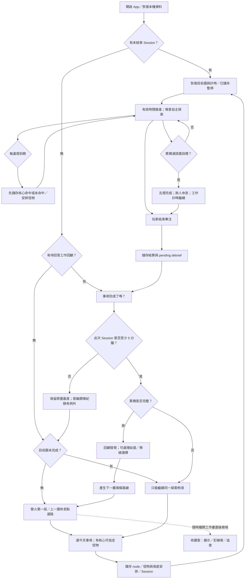
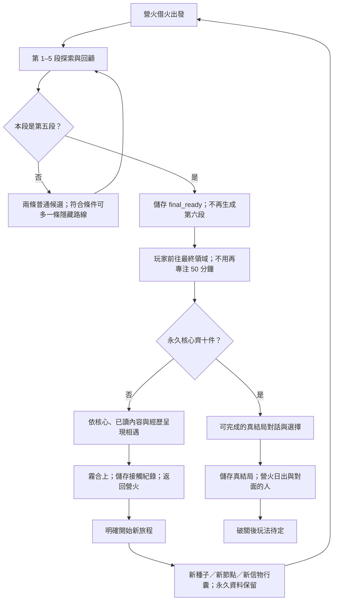

# Focus Quest 運作流程與儲存盤點

日期：2026-10-11。依目前 checkout 的正式程式與最新企畫修訂盤點；版本欄為 0.6.31，包含尚未重發安裝包的來源修改。本次未開啟遊戲視窗，也未接觸玩家存檔。

## 先看結論

專注、五燈、單圖探索、信物與核心儲存已有完整骨架。**整趟五段旅程還沒有形成閉環**：正式程式在第五段後仍生成第六段；最終相遇、返回營火、新旅程重置與三張隱藏地圖路線尚未接線。原型有相關畫面與狀態，不代表正式流程已經能走到。

來源優先順序：使用者指示 → 核心企畫的較新決策 → 已驗收地圖設計；判斷目前行為則以正式程式與本次隔離驗證為準。支援檔案的舊說明不覆蓋較新企畫。

## 名詞與目前範圍

| 名詞 | 定義 | 儲存界線 |
| --- | --- | --- |
| 專注 Session | 一次開始到結束的工作計時，可手動／系統暫停 | 起迄、有效時間、暫停狀態、事項回顧 |
| 探索例項 | 某次進入一張圖；可分多次 Session 完成 | 同一 node 儲存進度、物品安排、核心抽選、場景狀態 |
| 完整探索 | 新規格為累積 50 分鐘有效探索，五燈到期 | 探索完成次數與保底資格；不等於工作事項完成 |
| 一趟旅程 | 企畫為五段探索，可跨日 | 本趟路線、種子、信物；正式版尚未收束至五段 |
| 永久進度 | 核心、線索、世界記憶、缺頁與接觸紀錄 | 新旅程也保留；後兩者有結構／企畫，但主要取得流程未完成 |
| 幼苗 | 護根布包起後，玩家決定帶走的特殊狀態 | 明確例外：跨旅程保留直到種下，不當作普通訊物清空 |

正式路線池：01 雲上遺庭、02 苔痕驛站、03 倒影湖畔、07 玻璃苗圃。05 藏聲秋谷（暫名）是獨立試玩；04／06／08／09／10 及 h1／h2／h3 尚不在正式候選池。十件收藏模型不等於十張可玩地圖。

## 正式流程（實際可走）

兩個時機必須分開：有效時間到 50 分鐘時，後端可以記「完整探索／保底次數」；玩家結束 Session 後，才正式進回顧與下一段。超出 50 分鐘不增加下一次探索或新核心抽選。

**目前第五段也走 U → V → G。** 隔離完成五張圖後，大廳模型為 `choose_route`，內部段數 6、總段數 5、兩個下一段候選，完成旅程數 0。介面以 `min` 封頂顯示段數，不能當成真正完成旅程。

## 企畫要求的完整流程（尚未完成部分）

這張圖描述目標與待接線契約，不授權實作所有內容。最終對話、結局後玩法與重置細節仍需定案。

## 儲存、重置與恢復矩陣

| 資料 | 儲存時機／目前來源 | 跨日／重開 | 新旅程 | 盤點結果 |
| --- | --- | --- | --- | --- |
| 工作事項 | 玩家明確回答完成 | 保留；例行事項依日期另建 | 與遊戲旅程分開 | 已接線 |
| 工作有效時間 | 後端時鐘、暫停秒數、Session 結束紀錄 | 恢復既有 Session／暫停狀態 | 保留統計 | 已接線 |
| 單圖有效進度 | 合格 Session 結算；進行中用儲存進度加有效時間 | 同一 node 續玩 | 舊探索成歷史，新例項從 0 | 已接線；小於 5 分鐘不追加 durable 進度 |
| 路線與 seed | 生成時儲存候選，選路後儲存 selected node | 不因換日重抽 | 企畫要求新 seed | 儲存已接線；旅程結束／新旅程入口未閉環 |
| 普通訊物 | 出發時選定 item／lamp；到安排燈儲存發放 | 本趟保留 | 企畫要求本趟清空；收藏知識保留 | 現在可以在完整探索前取得；重複信物僅由行囊去重顯示，語意待定 |
| 核心抽選與保底燈 | 每盞後端時間到期先存；第五次開始先存保底燈 | 命中／未命中不重抽 | 永久保留 | 已接線；舊 25／90 分鐘探索不當新保底次數 |
| 地圖完整探索次數 | 五燈到期，50 分鐘達標 | 保留 | 保留 | 已接線 |
| 場景自主行為 | 場景後端狀態／雲上探索事件 ledger | 恢復位置、seed、已排事件 | 新例項重建 | 01 與 02／03／07 使用不同排程實作 |
| 地圖世界記憶 | 後端場景狀態／world marks | 保留 | 保留 | 已接線；非所有 ambient 都有永久影響 |
| 線索與釘選 | 事件紀錄／結算／首度取物；玩家釘選 | 保留 | 保留 | 已接線；單次探索卡片與永久線索分開 |
| 幼苗 | 驛站完成後選「帶走」；苗圃自主種下 | 保留 | 保留直到種下 | 已接線；不是普通訊物 |
| 移植 | 合格狀態在大廳選擇後先儲存結果 | 中斷不撤銷 | 保留小樹、刻度與筆記 | 已接線；不結束旅程 |
| 接觸、缺頁、真結局 | 企畫要求事件完成先儲存 | 應保留 | 應保留 | 最終相遇／缺頁取得目前沒有完整正式寫入入口 |
| 收藏首次放置與十件聯動 | 提供後端已展示／聯動標記 | 不應重播 | 保留 | 標記已接線；十件實際取得鏈不完整 |

## 已成立的設計與需補上的契約

已成立：工作完成與遊戲進度分離；Focus 不需要事件選擇；暫停凍結有效時間；核心與信物分池；回顧儲存且可重入；永久線索去重；苗圃移植不截斷旅程。

需補上：第五段結算 → 相遇 → 回營火的狀態機；完整的新旅程重置契約；隱藏路線與缺頁一次性取得；「已播放／已發現／已解讀」的共用語意；十圖與相遇的正式內容。

## 證據

- 企畫：§46.2–4、§46.8、§48.2／4、§49.2、§50.6–10、§52.7–8。
- [路線生成](../../../src/shared/expedition.ts)：四圖池、第一段特例、無隱藏路線引數。
- [正式資料流程](../../../src/main/database.ts)：`forestPlan`、`startFocus`、`processActiveSpecialFinds`、`beginSessionDebrief`、`chooseNextRoute`、`currentRun`。
- [大廳投影](../../../src/renderer/src/lobby/fromSnapshot.ts)：未產生正式 `final_ready`／`returned`，campfireStage 未進入真結局階段。
- [隔離驗證結果](verification.json)。完整既有測試：37 檔、208 項透過；另有本次隔離盤點 2 項透過。測試透過不代表企畫未實作功能已完成。
